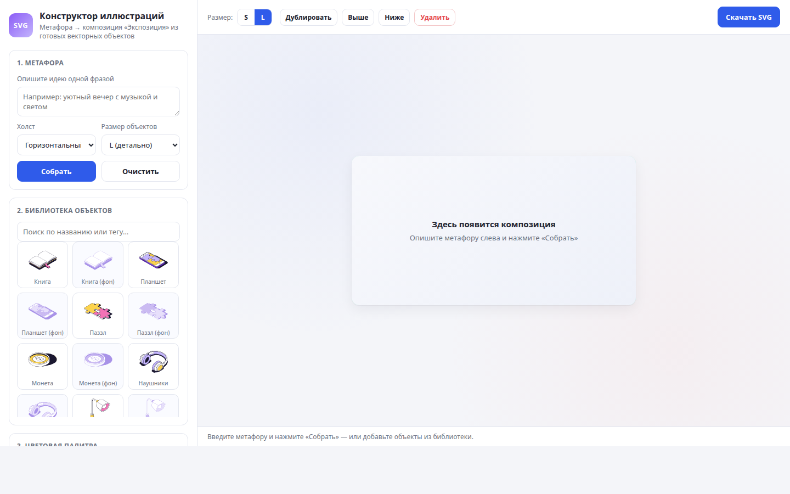
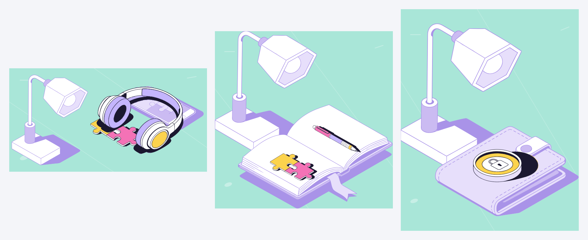

# Конструктор иллюстраций

Веб-сервис: по короткой метафоре собирает готовую иллюстрацию из векторной библиотеки.
Формат один — **«Экспозиция»**: сцена с одним смысловым центром, объектами в едином
масштабе и аккуратной глубиной.



## Что умеет

- **Метафора → композиция.** «Уютный вечер с музыкой» → наушники и ваза с цветами на мятном
  фоне. Смысл и роли выбирает LLM-«арт-директор», геометрию гарантирует детерминированный движок.
- **Три холста:** горизонтальный 600×315, квадратный 540×540, вертикальный 540×675.
- **Библиотека из 20 объектов** (10 главных + 10 фоновых) в двух детализациях (L / S).
- **Палитры:** три готовые схемы + загрузка палитры из картинки (цвета раскладываются по ролям).
- **Правки руками:** перетаскивание, поворот, масштаб, порядок слоёв, дублирование, удаление.
- **Экспорт SVG** — один векторный файл с уже подставленными цветами.

## Как это работает

1. `planner.py` — «арт-директор»: принимает метафору и возвращает **Composition Plan**
   (что взять, роли `hero / surface / accent / atmosphere`, что на что положить, фокус).
   Работает на локальной модели через Ollama, а если её нет — детерминированно по правилам,
   словарю ассоциаций и аффордансам объектов.
2. `layout.py` — исполняет план: герой в центре кадра, остальные объекты — кластером вокруг
   него, фон крупно в углу; объёмные предметы (наушники) всегда верхним слоем. Наложения
   проверяются по попиксельным маскам, геометрия считается по bbox с учётом поворота.
3. `frontend/` — vanilla ES-модули: рендер SVG, drag&drop, палитра, экспорт.



## Запуск

Всё поднимается в Docker — и приложение, и локальная модель. Нужен только Docker с Compose.

```bash
docker compose up -d --build                          # app на :8000 + Ollama на :11434
docker compose exec ollama ollama pull llama3.2:3b    # один раз: скачать модель (~2 ГБ)
```

Откройте <http://localhost:8000>, введите метафору и нажмите **«Собрать»**.

Без модели сервис тоже работает: план собирается детерминированно по правилам и словарю
(в ответе `resolved.source` будет `rules` вместо `ollama`).

Полезные команды:

```bash
docker compose logs -f app           # логи приложения
docker compose down                  # остановить
docker compose up -d --build app     # пересобрать после правок Python-кода
```

Фронтенд (`frontend/`), библиотека (`assets/`) и данные (`data/`) смонтированы в контейнер,
их правки подхватываются без пересборки.

### Локальная разработка (опционально)

Если нужен hot-reload или отладчик — приложение можно запустить и без контейнера, оставив
модель в Docker:

```bash
docker compose up -d ollama
python3 -m venv .venv && source .venv/bin/activate
pip install -r requirements.txt
OLLAMA_BASE_URL=http://localhost:11434 uvicorn app:app --reload --port 8000
```

## API

| Метод | Путь | Назначение |
|---|---|---|
| `POST` | `/api/compose` | `{query, canvas, size, scheme}` → сцена «Экспозиция» (пустой `query` → `400`; необязательный `format` — только `exposition`) |
| `GET` | `/api/library` | объекты, палитры, словарь синонимов |
| `POST` | `/api/palette` | `{colors: [...]}` → роли палитры |
| `GET` | `/api/health` | проверка живости |

Ответ `/api/compose` — готовая сцена: `width/height`, `background`, `decor`, `items`
(`id, x, y, scale, rot, z, state, variant`), `plan` и `resolved {ids, source, reason}`.

## Структура

```
app.py                  FastAPI: статика фронтенда + JSON API
planner.py              «арт-директор»: метафора → Composition Plan (LLM / правила)
layout.py               движок компоновки: роли, кластер, маски, холсты
catalog.py, palette.py  каталог объектов и роли палитры из набора цветов
assets/library/         20 объектов × L/S (SVG) + library.json
data/                   palettes.json, synonyms.json, masks.json, templates.json
frontend/               index.html, styles.css, js/* (vanilla ES-модули)
scripts/make_masks.py   генератор попиксельных масок (data/masks.json)
docs/                   скриншот и примеры для README
```

## Принципы композиции

- **Один мир.** Все объекты сцены живут в **одном масштабе**: пропорции берутся из манифеста
  библиотеки (лампа выше вазы, наушники крупнее монеты). Масштаб фона не «подгоняется» под
  место — вместо этого движок выбирает компоновку (фон сверху/сбоку), при которой общий
  масштаб получается наибольшим.
- **Один герой — в центре.** При нескольких главных объектах они собираются в кластер вокруг
  центра; при одном герое и фоне герой стоит по центру свободной части кадра.
- **Слои по физике:** наушники поверх всего, подложка (книга/планшет) — под содержимым.
- **Никаких наездов «по bbox»:** пересечения считаются по попиксельным маскам, поэтому герой
  может стоять вплотную к цветам, не задевая их.
- **Честный размер важнее «красивой картинки».** Если в наборе маленький герой (монета) и
  крупный фон (лампа), монета останется маленькой — пропорции не подменяются.

